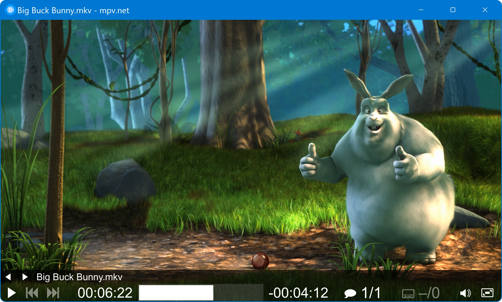
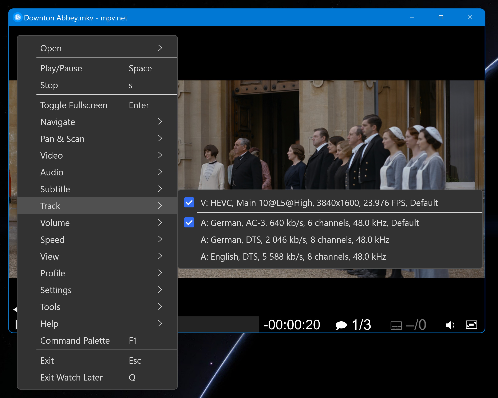
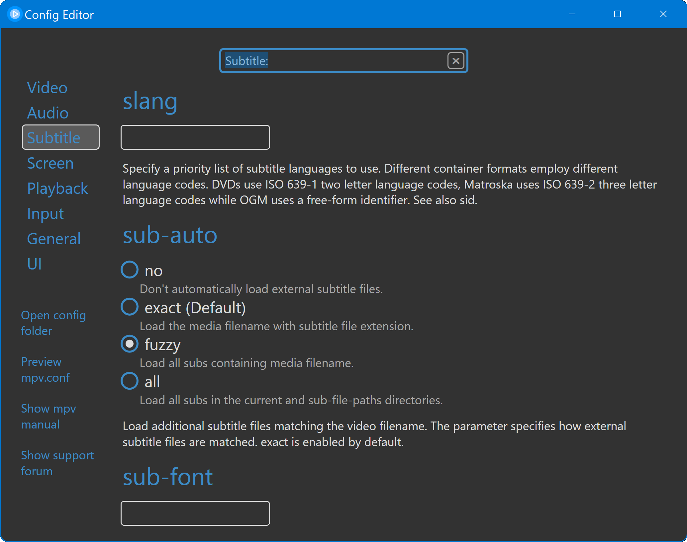
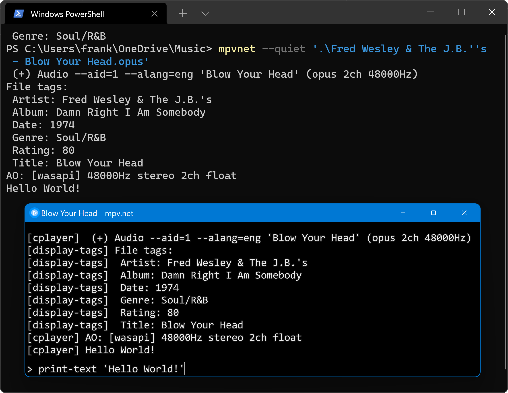
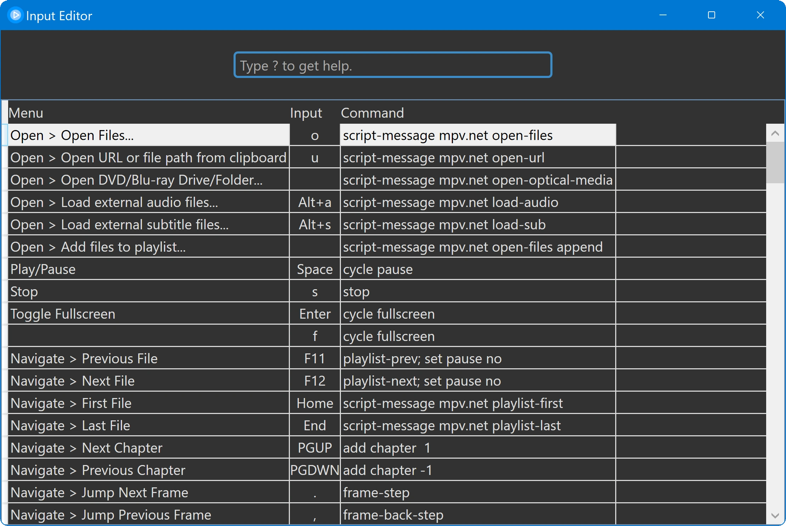
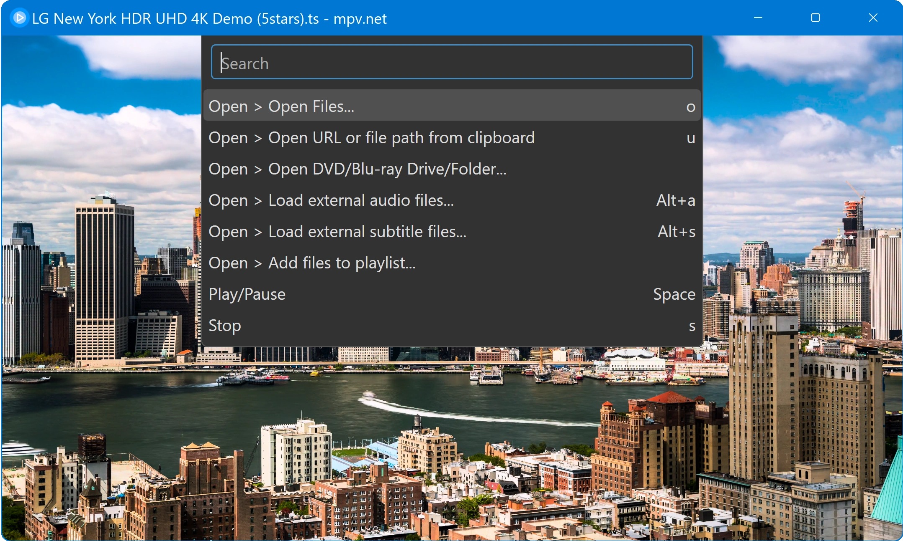
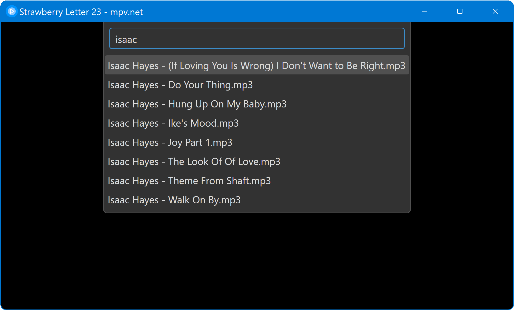

🎞 mpvnet
=========

> **本仓库说明：** 本项目基于开源项目 [mpv.net](https://github.com/mpvnet-player/mpv.net) 的 `v6.0.4.0-stable` 进行修改与续维护，原项目采用 [GPL-2.0](License.txt) 许可。向原作者 Frank Skare（stax76）及贡献者致谢。本仓库为个人维护构建，**不提供 issue 支持**。

mpv.net is a modern desktop media player for Windows based on the popular [mpv](https://mpv.io) player.

mpv.net is designed to be mpv compatible, almost all mpv features are available
because they are all contained in libmpv, this means the official
[mpv manual](https://mpv.io/manual/master/) applies to mpv.net.

mpv focuses on the usage of the command line and the terminal,
mpv.net retains the ability to be used from the command line and
the terminal and adds a modern Windows GUI on top of it.

#### Graphical User Interface

Modern GUI with customizable color themes.

#### Command Line Interface

mpv.net supports mpvs command line interface.

#### High quality video output

Video output that is capable of many features loved by videophiles,
such as video scaling with popular high quality algorithms,
color management, frame timing, interpolation, HDR, and more.

#### On Screen Controller

Play controls with a modern flat design.

#### GPU video decoding

Leverages the FFmpeg hwaccel APIs to support DXVA2 video decoding acceleration.

#### Based on libmpv

mpv.net is based on libmpv which offers a straightforward C API that
was designed from the ground up to make mpv usable as a library and
facilitate easy integration into other applications.
mpv is like VLC not based on DirectShow or Media Foundation. 

Table of contents
-----------------

- [Features](#features-that-mpv-and-mpvnet-have-in-common)
- [Support](#support)
- [Download](#download)
- [Manual](#manual)
- [Screenshots](#screenshots)

Features that mpv and mpv.net have in common
--------------------------------------------

- Lua and JavaScript Scripting
- Hundreds available user scripts make mpv the most feature rich desktop video player
- Simple config files that are easy to read and edit
- JSON IPC to control the player with a external programs
- On Screen Controler (OSC, play control buttons) with modern flat design
- Command Line Interface
- Started from a terminal status, error and debug output is printed on the terminal
- DXVA2 video decoding acceleration
- Video output capable of features loved by videophiles, such as video scaling with popular high quality algorithms, color management, frame timing, interpolation, HDR, and more
- Browser extensions to start mpv.net from the browser
- Fast seek performance
- Fast startup performance
- Usable as video player, audio player and image viewer with a wide range of supported formats
- Built-in decoders, no external codecs have to be installed
- Build-in media streaming (requires yt-dlp being installed)
- External audio and subtitle files can be loaded manually or automatically
- Screenshot feature
- Watch later feature to save the video position

Features exclusiv to mpv.net
----------------------------

- Very high degree of mpv compatibility, almost all mpv features are available
- Modern graphical user interface with customizable color themes
- Customizable context menu defined in the same file as the key bindings
- Searchable config editor
- Searchable input (shorcut keys) editor
- C# and PowerShell Scripting
- Global keyboard shortcuts
- Command palette to quickly and easily find commands and keys
- Extension API for .NET languages (C#, VB.NET and F#)
- Portable, MS Store or WinGet download and installation
- File history feature to log time and filename
- Files can be enqueued from File Explorer

## Support

本仓库不处理 issue，请自行排查或参考原项目文档。

## [Download](docs/Manual.md#download)

[Download section of the manual.](docs/Manual.md#download)

## [Manual](docs/Manual.md)

[The mpv.net documentation.](docs/Manual.md)

Screenshots
-----------

#### Main Window

#### Context Menu

Context menu using dark mode.

#### Config Editor

Searchable config editor as alternative to edit the conf file manually.

#### Terminal

OSD console and status printed on the terminal.

#### Input Editor

Searchable key and mouse binding editor.

#### Command Palette

Command Palette to easily find commands and shortcut keys.

#### Playlist

The command palette based playlist showing my favorite artist of the stax record label.

